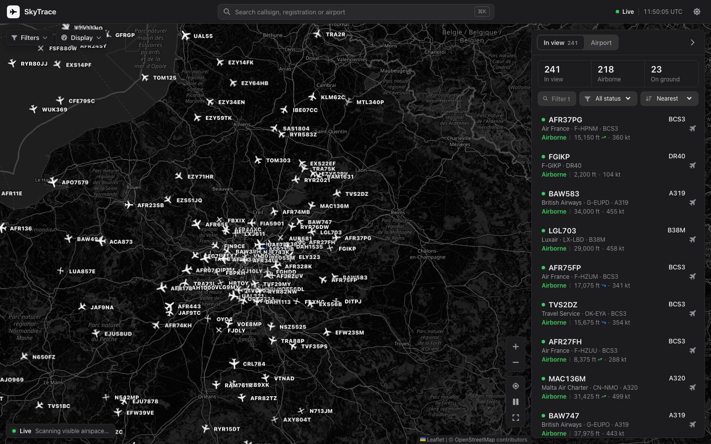
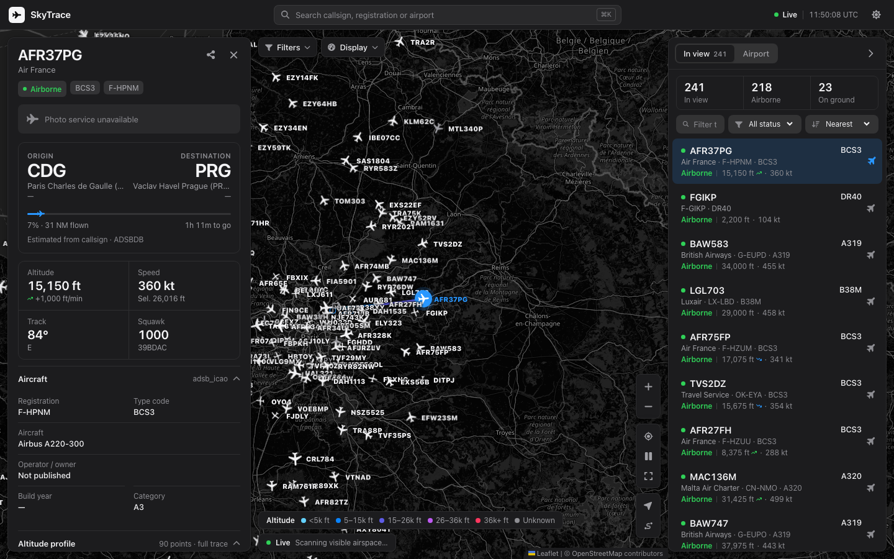
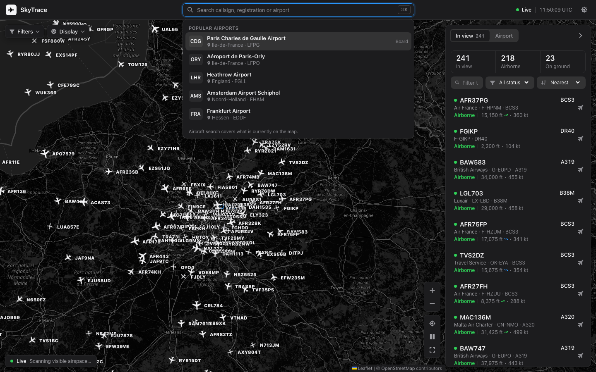
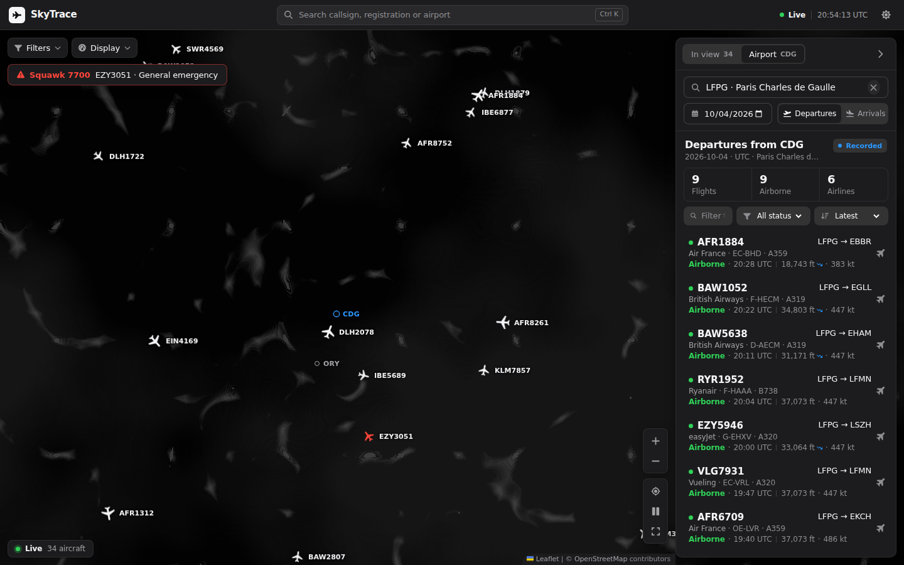
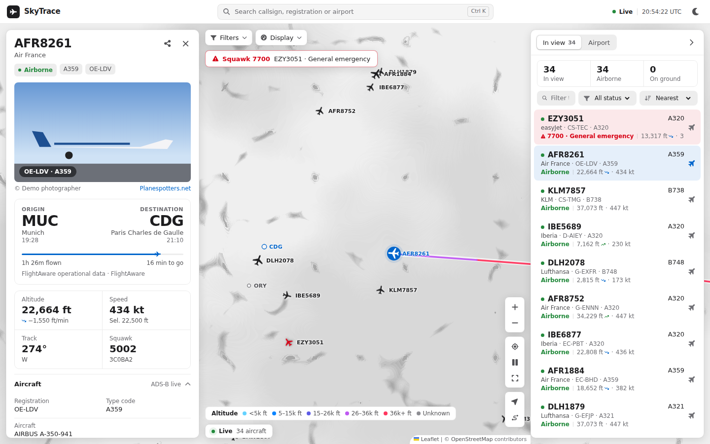
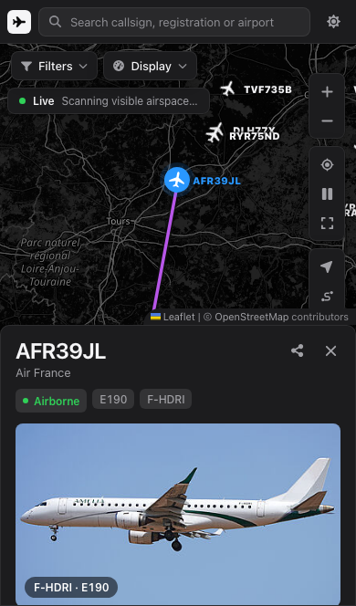

# SkyTrace

Navigation du projet : [carte du dépôt](docs/REPOSITORY.md) · [documentation](docs/README.md) · [tâches ouvertes](https://github.com/amassias/OpenSky-Flight-Tracking/issues).

Explore the aircraft above you, follow a flight across the map, or inspect traffic around an airport. SkyTrace combines live positions, recorded airport movements, route details and aircraft profiles in one responsive interface.

[Open the public demo](https://opensky-flight-tracking.vercel.app/) · [Run locally](#run-locally) · [Data and privacy](#data-and-privacy)

## What you can do

- **Explore live traffic.** Pan and zoom the map, filter aircraft by altitude or identity, switch units and map theme, and spot emergency squawks. Aircraft with enough position data glide between feed updates. Turn on **Display → Aircraft trails** to see where each aircraft has gone since you opened the page.
- **Inspect a flight.** Aircraft reveal callsigns at zoom 8, operating-airline logos at zoom 10, and altitude/speed at zoom 12. Screen-space collision detection keeps labels sparse; the selected aircraft keeps its detail label. Silhouettes follow the known aircraft type and airborne helicopter rotors respect reduced motion. Dense views keep the canvas layer for surrounding traffic. Hover an aircraft with a mouse or trackpad for a quick summary and, when available, its sourced photo with photographer credit; photos are requested only after a short hover. Select an aircraft for its ticket flight number (AF1234 for AFR1234), current altitude, speed, route, profile, photo and available operational details. The map makes one purposeful camera move; use **Follow** to stay with it or **Show full route** to frame its trace. Trace responses are checked against the aircraft, callsign and requested time; a missing trace never falls back to another flight. Links open the same aircraft on ADS-B Exchange, adsb.lol, FlightAware and Flightradar24 for cross-checking, and the ICAO24 hex code copies with one click.
- **Search in one place.** Find a visible aircraft by callsign, ticket flight number (`AF1234` finds `AFR1234`), registration, type or airline, or find an airport by name, city, IATA or ICAO code.
- **Find airports on the map.** Blue markers cover all geolocated airports in the bundled catalogue. Nearby markers form numbered groups; click to zoom in, then open arrivals and departures. Use **Display → Favourite airports only** to limit the markers to your saved airports.
- **Find airports near you.** Choose **Nearby airports**, allow browser geolocation, and open one of the five closest airports, sorted by distance. Distances are calculated in your browser. With your position shared, a selected aircraft also shows how far away it is and in which direction.
- **Explore an airport live.** Opening an airport shows its local time, sunrise and sunset, the latest METAR and TAF (flight category, wind, visibility, ceiling, QNH), the runways the wind favours, its runways and radio frequencies, and FAA delay programmes or ground stops for US airports. The board starts with FlightAware's next scheduled airline departures or arrivals (scheduled and expected gate times, gate, terminal, delays, cancellations), each joined by callsign to the aircraft seen live so arrivals show their live share of the route flown and an arrival estimate from their position. Below it, other live traffic: aircraft taxiing out or climbing away with their destination, and aircraft inbound, on approach or just landed with their origin and an estimated arrival time in airport-local time. Pick a row seen live to follow that flight on the map. The separate, collapsed **Weather guide · METAR & TAF** explains observation and forecast codes with illustrative examples. A scheduled flight without live detection stays separate from its assigned airframe: no earlier path is requested or shown.
- **Know the airframe.** A selected aircraft has an **Airframe history** section: registration, manufacturer and model, serial number (MSN), year built and age, the registered owner today, and a timeline of every owner, operator and registration the aircraft has had, with the registry or snapshot each entry comes from. A registration or hex code typed in the search field (`F-HBXA`, `N283VA`, `3986E0`) opens any airframe, even one that is not flying. A button loads the aircraft's recent flights on demand.
- **Review recorded movements.** Switch the airport board to **History** for OpenSky's UTC departures and arrivals on a given date, then filter or sort the list. When recorded movements are unavailable, SkyTrace labels the live airport snapshot clearly.
- **Watch aircraft.** Press the bookmark on a selected aircraft to save it (up to 20, in this browser only). **Alerts → Watching** lists them, says which are in the current map view, and opens any of them, even one that is not flying.
- **Keep your context.** Share a selected flight, an airport board or simply the map position (`?at=lat,lon,zoom`) by URL (the native share sheet on phones). Recent airports, up to eight favourites, map filters and display preferences stay in your browser; the first visit follows your system light or dark setting.

The same workflows are available on desktop and phone. Data coverage and enrichment depend on the providers; unknown routes and delayed feeds are labelled in the interface.

## Real screenshots

These are **browser screenshots of the running site**, captured on 5 October 2026 from the current local frontend connected to the public SkyTrace API. The maps use real OpenStreetMap tiles and the aircraft are live API responses. No traffic, map tiles or photos were generated for these images. Live positions and availability will differ when you open the demo.

### Live map



### Selected flight



### Search and airport board





### Light theme and phone





## Keyboard shortcuts

| Key | Action |
| --- | --- |
| `⌘K`, `Ctrl K` or `/` | Focus search |
| `↑`, `↓`, `Enter` | Navigate and select search or flight results |
| `F` | Toggle following the selected aircraft |
| `R` | Frame the selected route |
| `T` | Switch between the dark and light map |
| `L` | Show or hide surrounding aircraft labels |
| `P` | Show or hide aircraft trails |
| `U` | Switch between aviation and metric units |
| `?` | Show the keyboard shortcuts |
| `Esc` | Close the active search, menu, full map or flight detail |

## Architecture

- **Frontend:** React, TypeScript, Vite, TanStack Query, MapLibre GL
- **Backend:** Python `http.server`, Requests, python-dotenv
- **Data:** OpenSky REST API plus the bundled airport and airline datasets. On Vercel, the authenticated proxy serves complete viewport boxes; public ADS-B sources are used only as a resilient fallback. A selected live aircraft can request short-lived callsign, aircraft-profile, and FlightAware operational enrichment; the interface labels the source of each route.
- **Tests:** Vitest, Testing Library, pytest, and Playwright

Current-flight altitude profiles use TheAirTraffic's public full/recent traces, with ADSB.lol as an independent fallback. The backend validates aircraft, callsign and observation time, caches the selected flight, and refreshes a delayed full-day file with recent observations from the same provider. Each profile credits its actual source and shows the last recorded point in UTC. Free sources have coverage gaps and no verified availability guarantee; see the [provider comparison](docs/audits/2026-10-17-free-altitude-providers.md) and [trace decision](docs/adr/0003-independent-current-flight-traces.md).

The Python server owns all OpenSky authentication. Credentials are never sent to the browser.

## Run locally

Requirements:

- Node.js 22+
- Python 3.10+
- An [OpenSky Network](https://opensky-network.org/) API client

Install dependencies:

```bash
npm install
python3 -m pip install -r requirements-dev.txt
```

Create the local environment file:

```bash
cp .env.example .env
```

Then set both values in `.env`:

```dotenv
OPEN_SKY_CLIENT_ID=your_client_id
OPEN_SKY_CLIENT_SECRET=your_client_secret
```

Never commit `.env`. It is already ignored by Git.

## Development

Start the API server:

```bash
python3 -m backend.server
```

In another terminal, start Vite:

```bash
npm run dev
```

Open `http://localhost:5173`. Vite proxies `/api` to the Python server at `http://localhost:8000`.

### Live mode with the deployed APIs

If local OpenSky credentials are unavailable, set `SKYTRACE_API_ORIGIN=https://opensky-flight-tracking.vercel.app` in `.env.local`. The frontend remains on `localhost:5173` for Impeccable Live, while `/api` is proxied to the authenticated production backend. Do not put API secrets in this setting.

## Production build

```bash
npm run build
python3 -m backend.server
```

The server automatically serves `dist/index.html` and its hashed assets. Open `http://localhost:8000`.

## Validation

```bash
npm run lint
npm run test
python3 -m pytest -q
npm run build
npm run test:e2e
```

Unit and E2E tests use deterministic API responses and do not consume OpenSky credits. To perform a live smoke test, configure `.env`, run both servers, and verify health, airport search, arrivals, departures, viewport traffic, and a flight track.

## API endpoints

- `GET /api/health`
- `GET /api/search-airports?q=...&limit=...`
- `GET /api/airports`
- `GET /api/flights?airport=ICAO&date=YYYY-MM-DD&mode=departure|arrival`
- `GET /api/fetch-flights?...` — compatibility alias
- `GET /api/live-flights?lamin=...&lomin=...&lamax=...&lomax=...`
- `GET /api/flight-info?icao24=...&callsign=...`
- `GET /api/track?icao24=...&time=...`

## Data and privacy

The application stores only theme, units, display options (labels, airport markers, panel state, altitude and ground filters, list sorting; free-text filters last for the session), live-refresh preference, recent airports (which you can clear), and favorites in browser `localStorage`. No user account or personal flight history is created. Map tiles come from OpenStreetMap. Flight history comes from OpenSky; on Vercel, the public live fallback uses ADSB.fi first, then ADSB.lol. Airframe history is free and keyless. OpenSky publishes dated copies of its [aircraft database](https://s3.opensky-network.org/data-samples/metadata/); `scripts/build_aircraft_history.py` compares eleven of them (November 2020 to August 2025) and stores each aircraft's changes of registration, owner and operator in `data/aircraft-history/`, so those are dated to a snapshot month and stop at the newest snapshot. For aircraft ever registered in the United States, `scripts/build_faa_registry.py` adds the FAA's public [aircraft registry](https://www.faa.gov/licenses_certificates/aircraft_certification/aircraft_registry/releasable_aircraft_download) (`data/faa-registry/`): the current registration and every earlier one of the airframe with exact dates, city and state, and the export country. The FAA data keeps no street addresses, and individuals', partners' and co-owners' names are not stored: those registrations read "Private owner" (an organisation filter also applies to N-registered owners from OpenSky). The registered owner today comes from the keyless [ADSBDB](https://github.com/mrjackwills/adsbdb) registry (cached a day). US registrations convert to their ICAO24 code arithmetically; other countries resolve through ADSBDB. Recent flights are one FlightAware page per tail, cached an hour and counted against the same budget below. Refresh the datasets by re-running the two scripts on newly downloaded files.

The scheduled board uses one FlightAware AeroAPI page (15 flights, $0.005) per airport and direction, only for the direction on screen, cached ten minutes in the function and at the Vercel CDN so every visitor of that airport shares it. Each function instance stops calling AeroAPI after `SKYTRACE_AEROAPI_MONTHLY_PAGES` (default 600, about $3 of the Personal tier's $5 monthly allowance) or `SKYTRACE_AEROAPI_HOURLY_PAGES` (default 60) pages; selected-aircraft lookups count against the same ceilings and reuse a flight the board already fetched. AeroAPI has no usage endpoint, so these per-instance counters are a safety net rather than an account-wide cap; `/api/health` reports them. The live airport board is built from ADS-B positions within 150 NM of the airport (one public-provider request per refresh) and each callsign's usual route from the [adsb.lol route database](https://github.com/adsblol/vrs-standing-data). It is an observation, not a timetable: aircraft that have not switched on their transponder yet do not appear, and arrival times are estimated from distance and ground speed. Weather comes from the [NOAA Aviation Weather Center](https://aviationweather.gov/data/api/) (the nearest station within 50 km when the airport has no METAR), US delays from the [FAA NAS Status](https://nasstatus.faa.gov/) feed, and runways and frequencies from the bundled [OurAirports](https://ourairports.com/data/) snapshot in `data/airport-details.json` (rebuild it with `scripts/build_airport_details.py`). The favoured runway is a wind-only estimate. Each source fails on its own, and a rate-limited board falls back to the authenticated feed, the map's recent snapshot, then its last good result, labelled as delayed. If OpenSky history is unavailable, an airport search returns a clearly labelled live snapshot around the airport so the map and list remain useful; it does not claim those aircraft are historical movements.

Origin and destination for historical records come from OpenSky. For a live aircraft, the selected callsign is resolved on demand through the [ADSBDB callsign API](https://github.com/mrjackwills/adsbdb) and, when configured, the FlightAware AeroAPI connected to the Hermes flight-tracker skill. Both enrichments are cached briefly; a missing or disabled source leaves the route explicitly unknown. The selected hex code also gets a one-shot profile lookup from the ADS-B provider, including registration, type, operator and signal fields. Set `SKYTRACE_ROUTE_LOOKUP_ENABLED=0` or `SKYTRACE_FLIGHTAWARE_ENABLED=0` to disable either enrichment.

FlightAware data is fetched server-side with `FLIGHTAWARE_AEROAPI_KEY`; the key is never sent to the browser. A selected aircraft triggers at most one operational lookup per cache window, with failed lookups held for the retry window. The flight dock shows status, scheduled/estimated/actual times, delays, progress, gates, terminals, and filed route when the provider publishes them.

Live viewport requests use a short in-process cache, a small client request spacing, and a provider-aware refresh cadence. OpenSky state queries cost 1–4 credits based on bounding-box area; the default `SKYTRACE_OPENSKY_DAILY_BUDGET=3000` targets 3,000 of the standard 4,000 daily credits and yields roughly 30/60/90/120-second polling for increasingly wide boxes. If the configured credentials are rejected, the private proxy can serve current boxes anonymously at a slower cadence sized for the 400-credit anonymous bucket; set `OPEN_SKY_PROXY_ANONYMOUS_FALLBACK=0` to disable that path. The public ADS-B fallback respects the 250 NM point-endpoint limit by merging a bounded grid for wider viewports (`SKYTRACE_LIVE_MAX_TILES`, default 36), pacing cells 1.3 seconds apart by default, and lengthening its polling interval as the grid grows.

## Provider choices

The production stack keeps OpenSky for recorded airport history and complete live bounding boxes when the private proxy is available, then uses [ADSB.fi](https://github.com/adsbfi/opendata) and ADSB.lol for public live coverage. ADSB.fi public endpoints are limited to one request per second and personal, non-commercial use. Current-flight altitude profiles use TheAirTraffic with ADSB.lol as a separate trace fallback. Airplanes.live was removed on 18 October 2026 after its operator confirmed contributor-only access from a feeder IP and sponsorship requirements for applications.

For a materially faster and quota-free local setup, the most reliable option is a nearby ADS-B receiver running `readsb`/`tar1090`; the server can consume that local feed and use OpenSky only for history and enrichment. Check each provider's current terms before enabling commercial or high-frequency use: [OpenSky REST API](https://github.com/openskynetwork/opensky-api/blob/master/docs/free/rest.rst), [OpenSky terms](https://opensky-network.org/about/terms-of-use), [ADSB.lol open data](https://www.adsb.lol/docs/open-data/api/), and [ADSB.fi limits](https://github.com/adsbfi/opendata#limits).

## Emergency signals and diversion evidence

The **Alerts** traffic tab requests global squawks 7500/7600/7700 from the open-source [adsb.lol API](https://api.adsb.lol/docs). It refreshes only while that tab is open, once a minute, with a shared server/CDN cache. Feed failures are labelled unavailable rather than an empty sky. Complete callsigns can also be searched outside the map viewport; ticket flight numbers cannot always resolve alphanumeric ATC callsigns.

The selected flight's [readsb trace](https://github.com/wiedehopf/readsb/blob/dev/README-json.md) supplies sampled emergency/priority codes and the observed change times, including a signal which has since cleared. The latest leg boundary, matching callsign and trace time prevent a previous flight's emergency being attached to the current one. ADS-B data does not establish medical or technical causes, and an absent code does not rule out an incident.

A diversion explicitly reported by the configured FlightAware source is labelled with that source and checked against the flight instance. An open-data alternative observes a sustained ground segment after airborne positions within 3 km of a catalogue airport, at least 30 km from the known planned destination. It is labelled **Possible diversion / return to origin · ADS-B estimate**, never confirmed; no inference is made from a heading change, taxiing alone, missing destination, historical selection or stale trace. The destination itself may come from a usual-callsign route, so geographic evidence remains provisional.

adsb.lol data is distributed under ODbL; its licence is separate from this repository's source-code licence. No scraping of AirNav Radar, new paid subscription or automated incident-cause claim is used.

## License

MIT

Interface icons are from [Font Awesome Free](https://fontawesome.com) (solid set) by Fonticons, Inc., licensed under [CC BY 4.0](https://fontawesome.com/license/free). Regenerate them with `node scripts/build-icons.mjs <fontawesome-free-web-folder>`.

Ticket flight numbers (AF1234) are matched to callsigns (AFR1234) with `src/shared/airlineCodes.ts`, generated from the bundled OpenFlights airline list by `python3 scripts/build_airline_codes.py`. Only active airlines with both an IATA and an ICAO code are kept.

### Airport schedules and data coverage

The map and airport board display observed traffic. No regional timetable integration is enabled: a planned-flight board needs a verified global provider. See [provider research and metadata provenance](docs/FREE_TIMETABLE_SOURCES.md).

### Worldwide alert reliability and tracking clarity

The worldwide squawk feed shares requests per server instance, retries transient failures once, and backs off after provider errors or rate limits. A delayed last observation is retained for at most five minutes, explicitly dated, and cannot be selected as a current live alert. Degraded responses are not CDN-cached. The feed remains dependent on public receiver coverage; no code establishes the cause of an incident.

Flight details put the route, measurements and operations before photographs and reference history. On mobile, details replace the list sheet with a return action. Airport boards distinguish local scheduled, estimated and actual times; recorded history remains in UTC. Keyboard tabs, named aircraft markers, larger panel text and targeted reduced-motion behaviour support the same workflows across devices.

Aircraft photos are requested in the browser from [Planespotters.net](https://www.planespotters.net/legal/termsofuse). When that service has no photo or cannot be reached, a photo may be shown from [Wikimedia Commons](https://commons.wikimedia.org/wiki/Commons:API/MediaWiki) only if its file title matches the aircraft registration exactly and its author and license are available. Commons results are marked as registration matches, with the author, license and original file page linked in the interface. No generic aircraft photo is substituted for a specific airframe.

Audit evidence and limitations: [13 October reliability and usability audit](docs/audits/2026-10-13-tracking-ux.md).

The second [observation-integrity audit](docs/audits/2026-10-13-observation-integrity.md) addresses matched operational route preference, historical-flight isolation, dated position observations, accessible time-scaled altitude inspection and expandable mobile details. Only the selected live trace refreshes automatically (every 90 seconds); failed refreshes retain the previous observations.


### Aircraft enrichment and selection

The drawer renders from the selected live state immediately. `/api/flight-route?callsign=AFR123` resolves the usual route separately from the slower aircraft/operations profile, photo and registry requests. Each lookup is abortable and cached under its own identity. Route coordinates travel in the response; geometric progress is explicitly estimated, and a usual callsign route never supplies a confirmed arrival time. Unknown progress and absent optional fields are hidden.

`/api/aircraft-enrichment?operator=AFR&type=A359&registration=F-HTYA` returns optional cabin configurations from `data/cabin-configurations.json`. The catalogue has 34 published layouts spanning 33 operator/type pairs. All entries include a source, check date, class counts and a seat-information link. Some European short-haul cabins have a movable Business/Economy boundary; these show the total capacity and explain why the split cannot be stated. Match levels are `operator_type`, `airframe` or null. A registration alone cannot promote a fleet layout to an exact match: that requires an explicit registration assignment **and** an assignment source. The catalogue currently makes no exact-airframe claims. Missing operator/type pairs return an empty list. Published capacities are not live inventory or availability; retrofits and substitutions may differ.

The catalogue uses airline publications and [AeroLOPA aircraft plans](https://www.aerolopa.com/aircraft), with no paid API or request-time scraping. To extend it, verify the precise ICAO type/operator combination and class totals, attach the source and check date, and add amenities only where that source identifies them for this configuration. Never carry amenities across variants. `data/aircraft-types.json` supplies the shared fallback model names. Airline marks are loaded on demand from Kiwi's airline-image CDN for explicitly mapped ICAO operators and selected unique mappings from the bundled [OpenFlights airline list](https://openflights.org/data.php) (ODbL; operator codes may become outdated). The dated `data/airline-logos.json` catalogue contains 388 checked assets, with 364 enabled. Twenty generic aircraft placeholders and four images for the wrong code holder are excluded; Southwest, Cargolux and Smartwings use sourced local replacements. Availability of an image alone does not validate its brand identity. Unknown or failed logos fall back to a stable three-letter operator badge when an operator code is available, and carrier trademarks remain their owners' property. A selected aircraft's long dashed guide is a direct geographic line to the known destination, not an ATC route; when no destination is known, only a short heading projection is shown.

A dashed arrow on the selection projects the reported heading for two minutes (at most 40 km). It is not a destination or filed route. It is omitted for historical/ground aircraft, invalid heading/speed or fixes over 60 seconds old. Emergency queries retry transient failures, bypass stale upstream cache entries, and fall back to three individual squawk requests if the combined endpoint rejects the query or returns malformed/stale data. All three must succeed; a partial answer never claims an empty worldwide sky. Last-good snapshots expire after five minutes.

### Airline-code corrections and cabin presentation

`data/airline-code-corrections.json` holds dated, sourced corrections to the historic OpenFlights table. Regenerate with `python3 scripts/build_airline_codes.py`; verify reproducibility without writing files with `python3 scripts/build_airline_codes.py --check`. Corrections replace the named IATA assignment and remove duplicate legacy aliases for the corrected ICAO operator. Search, ticket-number labels and airline logos consume the same generated table. The 2026-10-14 snapshot covers 363 usable rows from all 38 pages of the public IATA member directory, grouped into 362 assignments, plus two retained non-member corrections (364 assignments total). Shared/starred designators and entries without a valid ICAO code were skipped. This covers IATA members, not every operator worldwide. The same sourced names also enrich server responses; multiple operators sharing an IATA code retain distinct names.

Cabin classes and capacities appear before an optional, folded seat inventory. Each symbol represents one published seat; the grid does not reconstruct rows, aisles or available seats. Loading and errors are explicit, and a retry is available after a failed request. The inventory resets on aircraft selection; source and seat-map links remain available without expanding it. Altitude axes include dates when observations cross midnight UTC.

The new cabin/graph browser suite covers published data, empty and error states, keyboard inspection, both themes, 375/768/1440 px layouts and 200% text sizing. Live screenshots in the README are separate from deterministic browser checks; an automated real-tile visual baseline is still a future task.

Validation evidence: [14 October global quality audit](docs/audits/2026-10-14-global-quality.md).

Logo maintenance: `python3 scripts/check_airline_logos.py` validates the catalogue, sourced local files and aircraft-model metadata offline (also run by CI). `python3 scripts/check_airline_logos.py --online` checks enabled remote PNGs without editing the catalogue; `--iata AZ,VF,U2` limits network checks. A failed image retains the operator badge. Review reused designators against the dated IATA source before enabling a logo. Local replacements are unchanged source assets; `public/airline-logos/README.md` records attribution. Ten FAA-sourced type families extend `data/aircraft-types.json` to 69 entries, with provenance in `data/aircraft-type-sources.json`; a shared type code never confirms the exact airframe variant.

### Bulk airline logos

Run `python3 -m pip install -r requirements-dev.txt` and `python3 scripts/import_airline_logos.py` to download two pinned source archives and import missing operator marks in one batch. Use `--offline` to rebuild from the checksum-verified archives in `.cache/airline-logos/`. There is no scheduled sync or runtime provider lookup.

The import adds **411 local ICAO-indexed logos**, including **220 operators without IATA codes**, while preserving all existing validated assets and exclusions. It prefers the [ICAO dataset](https://github.com/imgmongelli/airlines-logos-dataset) and only accepts the [secondary dataset](https://github.com/amannuhman/airlines-and-logos) when the code assignment agrees with SkyTrace. Source snapshots, licences and per-image SHA-256 hashes are recorded in `data/airline-operator-logos.json`, `data/airline-logo-source-lock.json` and `data/airline-logo-sources/`. The compact generated runtime table keeps provenance out of the JavaScript payload.

`data/airline-logo-import-report.json` lists additions, already covered candidates, rejected associations/images and entries without a source image. Counts refer to source records, so the same operator can appear in multiple source outcomes. Conflicting codes, protected exclusions, duplicate identities, known placeholders, suspicious shared images, invalid PNGs and unsafe SVGs are rejected. Matching metadata cannot guarantee that every upstream brand is current; unsupported operators keep their existing initial badge. Re-running against the same snapshots produces identical files. `python3 scripts/check_airline_logos.py` validates committed assets, hashes and the generated runtime table without network access. Carrier trademarks remain their owners' property.

### Aircraft model silhouettes

The live map uses 39 GPLv2 model silhouettes for 60 explicit ICAO type/family codes, with reference records from OpenAircraftType (CC-BY-SA-3.0). A single SVG sprite is embedded in the initial HTML; markers reference its symbols without loading models or additional images. Unsupported types retain the category glyph. Dense views draw the same silhouettes on canvas, so zoom never replaces aircraft with dots. Known airframe type metadata survives a less detailed feed response; labels remain sparse to avoid overlap. Sources, licences, pinned checksums and the offline rebuild command are in [the silhouette catalogue](data/aircraft-silhouettes/README.md).
